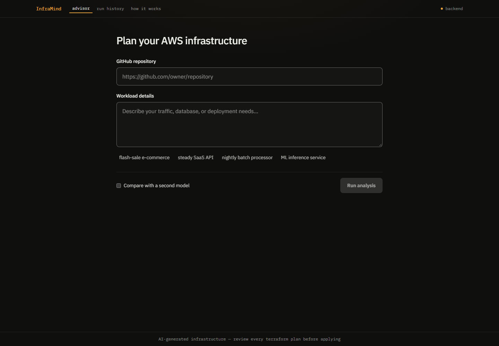
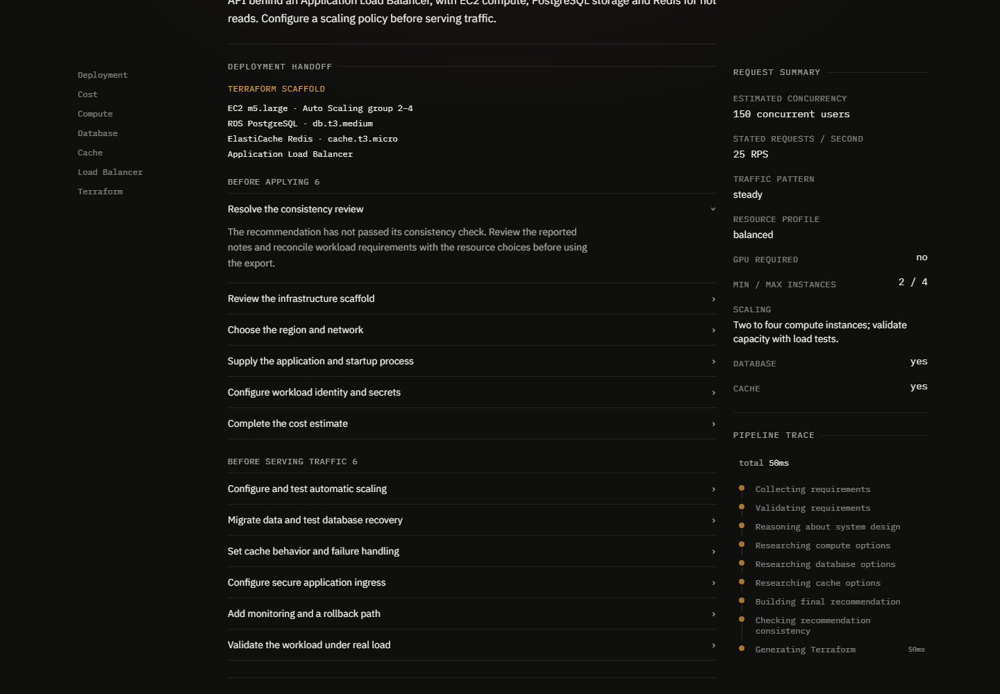
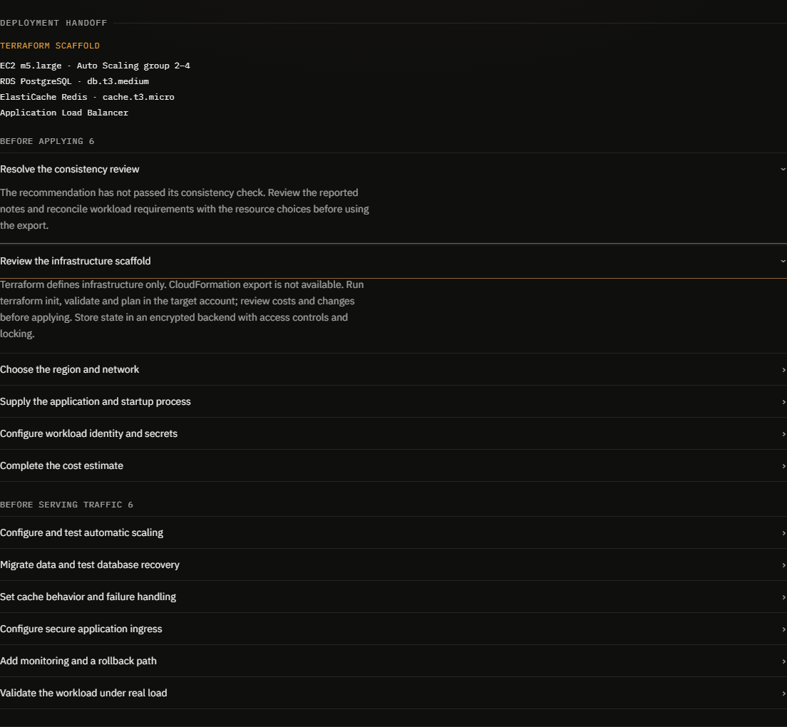
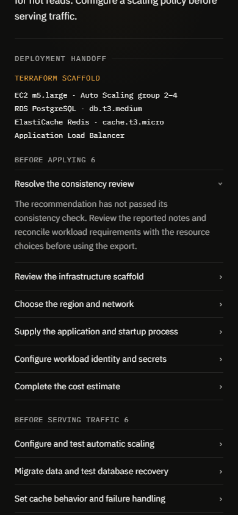

# InfraMind — AWS Instance Advisor.

[](https://github.com/PRITIK03/Infra-Mind/actions/workflows/backend-tests.yml)
[](https://github.com/PRITIK03/Infra-Mind/actions/workflows/frontend-tests.yml)

<p align="center">
  
</p>

InfraMind sizes AWS infrastructure from workload details, a public GitHub repository, or both. It recommends compute, database, and cache resources using live catalog data and exports a Terraform starting point.

Each new result includes a deployment handoff listing the generated resources and remaining work before applying infrastructure or serving traffic. It is useful for an initial architecture review and an engineering handoff. It does not deploy the application or certify its capacity or security. See [demo and release requirements](docs/DEPLOYMENT_READINESS.md).

This repository is a monorepo with two projects:

```
aws-instance-advisor/   ← Python backend (FastAPI + LangGraph agent)
aws-advisor-ui/         ← Next.js frontend (chat UI + results dashboard)
```

## From a question to an infrastructure handoff

InfraMind turns a rough workload description into a reviewable AWS plan: understand the workload, inspect an optional public repository, ground the recommendation against catalog data, then hand an engineer the concrete work still required before traffic goes live.

<table>
  <tr>
    <td></td>
    <td></td>
  </tr>
  <tr>
    <td align="center"><sub>Architecture recommendation</sub></td>
    <td align="center"><sub>Deployment handoff</sub></td>
  </tr>
</table>

<p align="center">
  
</p>

The output is intentionally a starting point, not a magic approval: it shows the selected resources, price scope, consistency status, Terraform export, and the decisions an engineer must verify for the target account and workload.

---

## How it works

1. You describe your application and expected workload (via CLI or the web UI).
2. The agent asks clarifying questions until it has enough context.
3. It reasons about system design — concurrency, resource profile, traffic pattern, scaling strategy.
4. It researches live EC2, RDS, and ElastiCache instance data.
5. It returns a full architecture recommendation (compute + database + cache + load balancer) with confidence scores and trade-offs.
6. Download the Terraform from the web result or find the CLI export in `aws-instance-advisor/terraform_output/`.

---

## Prerequisites

| Tool | Minimum version |
|------|----------------|
| Python | 3.11 |
| Node.js | 22.13+ (24 LTS used in CI) |
| npm | 10 |

---

## Quick start (local — both services)

### 1. Clone the repo

```bash
git clone https://github.com/PRITIK03/Infra-Mind.git
cd Infra-Mind
```

### 2. Set up the backend

```bash
cd aws-instance-advisor

# Create and activate a virtual environment
python -m venv .venv

# Windows
.venv\Scripts\activate
# macOS / Linux
source .venv/bin/activate

# Install dependencies
pip install -r requirements.txt

# Copy the env template and fill in your keys
cp .env.example .env
```

Open `.env` and set:

| Variable | Required | Description |
|----------|----------|-------------|
| `API_KEY` | Yes | Your OpenRouter API key |
| `BASE_URL` | Yes | OpenRouter base URL (`https://openrouter.ai/api/v1`) |
| `MODEL_NAME` | Yes | Model slug e.g. `anthropic/claude-3.5-sonnet` |
| `VANTAGE_API_KEY` | Yes | [Vantage](https://www.vantage.sh/) API key for live EC2 pricing data |
| `TAVILY_API_KEY` | No | Enables a web-search round during reasoning. Agent works without it. |
| `LLM_MAX_TOKENS` | No | Overall response token budget (default `8192`) |
| `LLM_REASONING_MAX_TOKENS` | No | Subset of `LLM_MAX_TOKENS` reserved for the model's internal reasoning; mapped onto OpenRouter `reasoning.effort` (default `2048`) |
| `LLM_FALLBACK_MODELS` | No | Optional comma-separated list of OpenRouter model slugs to try server-side when `MODEL_NAME` is rate-limited or unavailable. Additive to `API_KEY_2` failover. |
| `API_KEY_2` | No | Second OpenRouter key for automatic rate-limit failover |
| `CORS_ALLOWED_ORIGIN` | No | Frontend origin for cross-origin browser calls. The backend starts without it (cross-origin requests are then rejected), but the web UI needs it — use `http://localhost:3000` locally and the real Vercel domain in production |
| `PORT` | No | FastAPI port (default `8000`) |
| `DATABASE_URL` | No | Optional SQLite/Postgres URL enabling run-history persistence via `GET /api/runs`. Without it, jobs are process-local and lost on restart. |
| `RATE_LIMIT_MAX_REQUESTS` | No | Recommendation requests allowed per client IP per window (default `5`) |
| `RATE_LIMIT_WINDOW_SECONDS` | No | Recommendation rate-limit window (default `60`) |
| `MAX_CONCURRENT_STREAMS_PER_IP` | No | Cap on concurrently open SSE progress streams per client IP (default `5`). Applies instead of the requests-per-minute limiter to `GET /api/recommend/{job_id}/stream`. |
| `SSE_HEARTBEAT_SECONDS` | No | Idle interval after which an open progress stream sends a keep-alive comment and checks whether the client is still connected (default `15`) |
| `REDIS_URL` | No | Optional Redis URL enabling a persistent job store (survives restarts, shared across backend instances). Without it, jobs are in-memory only — fine for single-instance dev/demo. Records expire after 24h. |
| `SENTRY_DSN` | No | Optional Sentry Data Source Name for error monitoring (e.g. `https://<key>@o0.ingest.sentry.io/0`). The app runs identically without it; Sentry's free tier covers this project's scale. |
| `SENTRY_TRACES_SAMPLE_RATE` | No | Fraction of requests traced for performance monitoring (default `0.0` = error monitoring only). Keep `0.0` to protect free-tier quota. |
| `REPOSITORY_ANALYSIS_ENABLED` | No | Public GitHub analysis for HTTP jobs (default `true`). Set `false` to pause GitHub access while keeping workload-only analysis available. |
| `REPOSITORY_GITHUB_TOKEN` | No | Server-only GitHub credential with public read access for hosted traffic. Unset uses GitHub's anonymous public quota. |
| `REPOSITORY_OSV_SCANNER` | No | Absolute path to an installed OSV-Scanner v2 binary for optional offline dependency checks. Set `OSV_SCANNER_LOCAL_DB_CACHE_DIRECTORY` to the absolute path of the offline database cache. |
| `GITHUB_MCP_TOKEN` | No | Optional credential for the legacy terminal analyzer. HTTP jobs use the public GitHub REST integration. |
| `LOG_FORMAT` | No | Backend log output: `json` (default, one JSON object per line for aggregators) or `text` (human-readable for local dev). |
| `JOB_THREAD_POOL_SIZE` | No | Max simultaneous agent-run threads (default `8`, sized for small cloud hosts). |
| `JOB_TIMEOUT_SECONDS` | No | Hard wall-clock limit for one complete agent run in seconds (default `600`). |
| `MAX_SHUTDOWN_GRACE_SECONDS` | No | Grace period for in-flight jobs during shutdown in seconds (default `10`); the process exits after the cap even if jobs are still running. |

### 3. Start the backend API

From `aws-instance-advisor/`:

```bash
uvicorn app.api.main:app --reload --port 8000
```

⚠️ The ASGI application is `app.api.main:app` — never `app.main:app`.
`app.main` is the terminal CLI entrypoint; running `uvicorn app.main:app`
starts a server that silently returns 404 for every route.

The API will be available at `http://localhost:8000`. Verify with:

```bash
curl http://localhost:8000/api/health
```

### 4. Set up the frontend

From the repository root:

```bash
cd aws-advisor-ui
npm install
cp .env.example .env.local
```

`.env.local` only needs:

```
NEXT_PUBLIC_API_URL=http://localhost:8000
```

### 5. Start the frontend

```bash
npm run dev
```

Open `http://localhost:3000` in your browser.

---

## CLI mode (no frontend needed)

From `aws-instance-advisor/` with the venv active:

```bash
python -m app.main
```

---

## Running tests

```bash
# Backend
cd aws-instance-advisor
pytest -v

# Frontend
cd aws-advisor-ui
npm test            # runs Vitest
```

---

## Analyze a GitHub repository

Enter a public `https://github.com/owner/repo` in **GitHub repository**, paste it into **Workload details**, or use both fields. The backend resolves the default branch to a commit and reads its files before sizing AWS resources. A repository-only run can generate a provisional plan when the source identifies a workload. Expected traffic, availability targets, budget, and production database preferences can make the sizing more specific.

The report includes the analyzed commit, file coverage, detected stack and data stores, deployment and workflow evidence, potential credential exposure, and local versus hosted inference signals. Findings link to the corresponding GitHub files. Binaries, submodules, generated/vendor files, large files, and unreadable content are accounted for separately. The scan covers the pinned snapshot, with limits of 1 MiB per eligible file, 1,500 files, 8 MiB of selected source, and a 35-second scan budget. It does not execute repository code. Secret findings are pattern-based and values are never included.

If GitHub access fails, InfraMind explains the failure and identifies any recommendation that uses only workload details. GitHub can return the same response for a private or missing repository. Repository-backed jobs are kept off the public run history. Their share links use a separate ID and expose selected AWS resources and costs. The original report, Markdown, PDF, and Terraform remain available from the analysis itself.

**Optional dependency advisories.** Install a pinned [OSV-Scanner v2 release](https://github.com/google/osv-scanner/releases) and provision the npm and PyPI databases using the [offline mode instructions](https://google.github.io/osv-scanner/usage/offline-mode/). Give the backend read access to the executable and database cache. Set both paths in the backend environment and refresh the cache separately from user requests. The report tells users whether checks ran, including when there is no supported lockfile or the scanner is unavailable.

**Rollout.** For an existing production service, start with `REPOSITORY_ANALYSIS_ENABLED=false`, enable it in staging, and exercise a public repo-only run, a mixed run, an inaccessible repository, and a share link. Verify `/api/health/ready`, GitHub quota, SSE and polling, and worker capacity before enabling production traffic. The scan limit and cooldown are per backend process. For a multi-replica deployment, apply a shared quota at the gateway and keep clarification requests routed to the worker that owns the run.

---

## Optional integrations & operational notes

> Every item below is optional. Left unset, the app starts and runs exactly as in the minimal install above — mirroring the same graceful-skip pattern used for `TAVILY_API_KEY` and `DATABASE_URL`.

**Redis (`REDIS_URL`)** — Without it, jobs live in process-local memory only (fine for single-instance dev/demo). Set it to survive backend restarts and to share jobs across multiple instances/pods; job records carry a 24h TTL so Redis doesn't grow unbounded.
> ⚠️ Resume-path caveat on multiple instances: `AgentState` (live candidate lists and Pydantic objects) is intentionally **not** persisted to Redis — it's process-local working memory for the thread executing the job. `POST /api/recommend/{job_id}/answer` therefore has to reach the *same* instance that owns the job. If you scale beyond one backend instance, either pin all job execution to a single replica, or terminate TLS and enable sticky sessions / instance-affinity routing so `/answer` is routed to the correct instance. `GET /api/recommend/{job_id}` polling is fully safe to load-balance.
> 📡 Progress streaming follows the same rule: with `REDIS_URL` set, job events fan out across replicas over Redis Pub/Sub, so `GET /api/recommend/{job_id}/stream` may attach to any instance. Without it, the stream (like the job itself) is served only by the instance that owns the job.

**Sentry (`SENTRY_DSN`)** — Optional error monitoring via `sentry-sdk`. When set, **unhandled** route exceptions that produce HTTP 5xx are captured automatically by the FastAPI integration — no per-route wiring, and `HTTPException` responses (e.g. the 404/429 above) are intentionally **not** reported. The wall-clock job-timeout path and graph exceptions are caught deliberately by `app/api/main.py` and never reach FastAPI, so those two are reported explicitly (`capture_exception` / `capture_message`); all of it is a silent no-op when `SENTRY_DSN` is unset. Sentry's free tier covers this project's scale. `SENTRY_TRACES_SAMPLE_RATE` defaults to `0.0` (error monitoring only — tracing burns free-tier quota fast).

**GitHub MCP (`GITHUB_MCP_TOKEN`)** — Optional for the terminal workflow. The web app and HTTP API use the public repository scan described above.

**Real-time progress streaming (`GET /api/recommend/{job_id}/stream`)** — The API sends the current job snapshot on connect, then pushes progress, scan status, and terminal results as they change. SSE and polling use the same response shape. Streams close on completion, error, or disconnect, and the frontend falls back to polling if the stream fails. Redis Pub/Sub distributes updates across backend replicas when `REDIS_URL` is configured. `MAX_CONCURRENT_STREAMS_PER_IP` caps open streams per client.

**Conversational follow-up (`POST /api/recommend/{job_id}/followup`)** — Once a recommendation job reaches `done`, users can ask natural-language follow-up questions against the completed architecture. The endpoint answers directly from the computed recommendation context and persists Q&A history on the job record (supported across both in-memory and Redis backends). It performs a focused single LLM call and never re-runs requirement gathering, research, or Terraform generation. Questions requiring fresh workload profiling or live AWS data are declined honestly.

**CI/CD (status badges at the top of this file)** — GitHub Actions run `Backend Tests` (pytest) and `Frontend Tests` (Vitest + `next build`) on push to `main`/`V2` and on PRs into those branches. The frontend workflow installs a *pinned* `@rolldown/binding-linux-x64-gnu` (exact version taken from `package-lock.json`) — a workaround for npm's optional-dependency bug `npm/cli#4828`, without which `npm ci` succeeds (exit 0) but the platform binding is silently omitted and vitest exits immediately at startup. Don't remove that step if the frontend tests ever start failing with "Cannot find native binding".

---

## Docker Compose (Backend + Redis Stack)

A complete local backend and Redis stack can be brought up from the repository root:

```bash
docker compose up -d
```

> Requires the Compose v2 `docker compose` plugin (2.24+, which added the
> `env_file` `path`/`required` syntax used in `docker-compose.yml`). The stack
> boots without a `.env` file — the required secrets fall back to dummy
> placeholders (the same dummy-env pattern the CI test workflow uses), so it
> comes up for a smoke test. For real recommendations, set credentials in
> `aws-instance-advisor/.env` and run
> `docker compose --env-file aws-instance-advisor/.env up -d --build`.
> The explicit `--env-file` supplies Compose interpolation values; the service
> `env_file` alone does not override dummy defaults in `environment`.
> Exported shell variables take precedence over the interpolation file.
This spins up:
- **FastAPI Backend:** Containerized Python 3.11 environment on port `8000`.
- **Redis Instance:** Local Redis 7 (`redis:7-alpine`) on port `6379` wired automatically via `REDIS_URL=redis://redis:6379/0`.

> **Note on Frontend:** The Next.js frontend is intentionally omitted from Docker Compose to keep local hot-reloading fast and lightweight via `npm run dev`. Run `cd aws-advisor-ui && npm run dev` alongside docker-compose.

To verify the stack readiness:
```bash
curl http://localhost:8000/api/health/ready
```

---

## Architecture & Engineering Decisions

For an in-depth breakdown of the multi-tier LangGraph reasoning graph, Mermaid architecture diagrams, and notable technical decisions (e.g. deterministic Terraform generation, SSE vs WebSockets, anti-hallucination grounding, and multi-model consensus), see [ARCHITECTURE.md](ARCHITECTURE.md).

---

## Docker (backend only)

From `aws-instance-advisor/`:

```bash
docker build -t infra-mind .
docker run -p 8000:8000 --env-file .env infra-mind
```

---

## Using the Terraform export

The result's **Deployment handoff** is derived from the same completed recommendation as the export. It covers application startup, network and identity configuration, full-cost budgeting, data migration and recovery, monitoring, and workload-specific decisions for batch jobs, model serving and external databases. The web ZIP includes these steps in `DEPLOYMENT.md`; Markdown and PDF exports include them too. Repository share links remain a restricted resource-and-cost summary.

Terraform is the available export format. CloudFormation generation and ECS/Fargate provisioning are not implemented; the Fargate section is sizing advice only.

The export assumes the account's default VPC, default subnets, and a stock Amazon Linux 2023 image. Configure your private subnets, application bootstrap, TLS, IAM, scaling policies, and monitoring for the target workload. The RDS template uses Secrets Manager for its master credential, encrypted storage, seven days of automated backups, and deletion protection. Grant the application a separate least-privilege database user.

Run `terraform init`, `terraform validate`, and `terraform plan` for the target account and region before applying. The monthly estimate uses `us-east-1` prices for the selected compute, database, and cache instances. Include storage, networking, load balancer, and Secrets Manager charges in your deployment budget.

When updating an older export in place, review the plan for replacements. Enabling encryption on an existing unencrypted RDS database requires a snapshot migration. An NLB created without security groups requires replacement to use one.

## Deploying to Vercel

Deploy the backend separately (Render, Railway, Fly, etc.) using
`aws-instance-advisor/Dockerfile`. Set `CORS_ALLOWED_ORIGIN` to the final
Vercel frontend origin.

In Vercel, set **Root Directory** to `aws-advisor-ui` and configure:

| Variable | Required | Description |
|----------|----------|-------------|
| `NEXT_PUBLIC_API_URL` | Yes | Public HTTPS URL of the deployed backend API, without a trailing slash. |

---

## Project structure

```
.
├── aws-instance-advisor/      # Python backend (FastAPI + LangGraph agent)
│   ├── app/                   # FastAPI + LangGraph agent
│   ├── tests/                 # pytest suite
│   ├── terraform_output/      # Generated Terraform (git-ignored)
│   ├── Dockerfile
│   ├── requirements.txt
│   └── .env.example
│
├── aws-advisor-ui/            # Next.js frontend (chat UI + results dashboard)
│   ├── src/
│   ├── public/
│   ├── package.json
│   └── .env.example
│
├── result_dump.json           # Saved agent result for screenshot / regression testing
└── README.md                  # this file
```

Backend details: see [aws-instance-advisor/README.md](aws-instance-advisor/README.md).

---

## API reference

| Method | Endpoint | Description |
|--------|----------|-------------|
| `GET` | `/api/health` | Liveness probe |
| `GET` | `/api/health/ready` | Readiness probe: required config present, Redis `PING` when `REDIS_URL` is configured, configured-integrations status; 503 only when required config is missing |
| `POST` | `/api/recommend` | Start a new job with `message`, `github_url`, or both. Optional `consensus` defaults to `false`. |
| `GET` | `/api/recommend/{job_id}` | Poll job status / result |
| `GET` | `/api/recommend/{job_id}/stream` | Live progress stream (SSE, `text/event-stream`) — current state on connect, one event per transition, closes on `done`/`error` |
| `POST` | `/api/recommend/{job_id}/answer` | Reply to an agent clarifying question `{ "answer": "..." }` |
| `POST` | `/api/recommend/{job_id}/followup` | Ask a follow-up question on a completed recommendation `{ "question": "..." }` |
| `GET` | `/api/stats` | Live instance-type counts (EC2 / RDS / cache) for landing page readouts |
| `GET` | `/api/runs` | Paginated run-history list; query params `?page=1&page_size=20` |
| `POST` | `/api/recommend/{job_id}/share` | Create the completed job's share link and return `{ "share_id": "..." }`. |
| `GET` | `/api/share/{share_id}` | Read a completed shared recommendation. Existing workload-only links continue to accept the job ID. |

Job status values: `collecting` → `running` → `awaiting_input` → `done` / `error`

